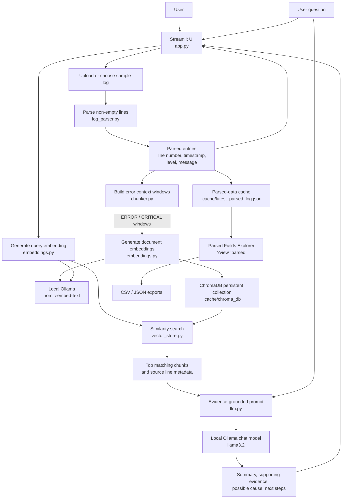
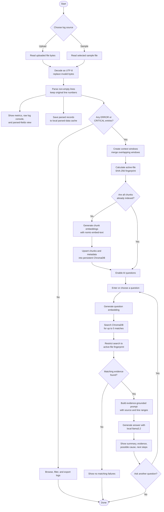

# AI Log Analysis Assistant

AI Log Analysis Assistant is a local Streamlit application for exploring application and service logs. It parses log lines into structured fields, highlights error context, indexes that context for semantic search, and uses a local Ollama language model to answer questions grounded in retrieved log evidence.

## Features

- **Upload logs or try built-in samples.** Accepts `.log`, `.txt`, and `.out` files and includes sample scenarios for database outages, application crashes, authentication incidents, network failures, and a Spark cluster log.
- **Parse common log formats.** Extracts original line numbers, timestamps, severity levels, and messages. Recognizes ISO-style, numeric-date, Apache-style, and syslog-style timestamps, and common severity labels such as `ERROR`, `CRITICAL`, `WARN`, `INFO`, and `DEBUG`.
- **Focus analysis on failures.** Builds context windows around `ERROR` and `CRITICAL` entries, including up to three parsed entries before and after each failure. Overlapping or adjacent windows are merged.
- **Ask questions in natural language.** Retrieves up to five semantically relevant failure chunks and asks the local `llama3.2` model to summarize evidence, discuss possible causes, and suggest next steps.
- **Inspect the source and evidence.** The response prompt requests citations to source files and line ranges; retrieved chunks and their Chroma cosine distances are also shown in the UI.
- **Explore and export parsed records.** The parsed-fields view supports text search, severity filtering, row limits, and CSV/JSON downloads.
- **Filter and download raw logs.** The console supports keyword, error-only, and warning-only filters, display limits, and downloads of the original or filtered log.
- **Keep inference local by default.** Embeddings and chat completion use Ollama at `http://localhost:11434`; the vector database is persisted locally.

## Advantages

- **Faster troubleshooting:** Automatically locates error-related sections and retrieves relevant context, reducing manual scanning of long log files.
- **More useful context:** Includes nearby entries before and after failures, helping reveal the sequence of events around an incident.
- **Natural-language investigation:** Lets users ask questions about the logs instead of relying only on exact keyword searches.
- **Evidence that can be checked:** Shows retrieved excerpts and source line ranges alongside AI-generated explanations so findings can be compared with the original log.
- **Local-first analysis:** Uses local Ollama models and local ChromaDB storage by default, avoiding the need to send logs to a hosted AI API. Review your Ollama setup and local data-handling requirements before using sensitive logs.
- **Practical log exploration:** Provides structured fields, severity and keyword filters, and CSV/JSON exports for follow-up analysis.

This application is a troubleshooting assistant, not an automatic root-cause authority. AI explanations are suggestions and should be verified against the original logs and relevant system context.

## Architecture



## Workflow

The flow below shows what happens from log selection through indexing and AI-assisted investigation:



## How analysis works

1. **Read and parse:** `app.py` decodes the selected file as UTF-8 (replacing undecodable bytes) and passes its contents to `parse_log_lines`. Empty lines are skipped while original line numbers are retained.
2. **Build failure context:** `create_event_chunks` selects parsed entries whose level is exactly `ERROR` or `CRITICAL`. By default, it includes three entries on each side of each selected entry and merges overlapping or adjacent windows. Logs without these levels can still be browsed, but do not produce AI-analysis chunks.
3. **Index locally:** `ChromaVectorStore` creates embeddings with Ollama's `nomic-embed-text` model and upserts them into a persistent ChromaDB collection using cosine distance. Each chunk carries source name, line range, chunk index, and failure-line metadata.
4. **Scope retrieval to the active file:** The app calculates a SHA-256 identifier from the filename and file bytes. It uses this identifier when indexing and searching so a question is matched against chunks for the active upload or sample.
5. **Retrieve and answer:** The question is embedded and used to retrieve at most five chunks for the active file. `generate_log_analysis` gives those chunks and the question to Ollama's `llama3.2` model. Its prompt treats logs as untrusted evidence, asks the model not to invent facts, distinguishes observations from possible causes, and requests cited line ranges.
6. **Display and export:** The main view shows the answer and retrieved evidence. A separate parsed-fields view is available at `?view=parsed`; parsed entries are cached in memory and in `.cache/latest_parsed_log.json` so they can be displayed in another browser tab.

## Technology

- Python 3.10 or newer
- Streamlit for the web interface
- Ollama for local chat and embedding models (via LangChain Ollama integrations)
- ChromaDB for persistent vector storage
- Pandas for parsed-log tables and exports
- `unittest` for the test suite

## Models used

Both models are called through the local Ollama service at `http://localhost:11434`:

| Purpose | Model | How it is used |
| --- | --- | --- |
| Embeddings | `nomic-embed-text` | Converts error-context chunks and user questions into vectors for semantic search in ChromaDB. |
| LLM / chat completion | `llama3.2` | Analyzes the question together with the retrieved log evidence and generates the troubleshooting response. |

### Why does the app call an LLM?

Embeddings help the app find log chunks that are semantically related to a question, but they do not explain what those logs mean or produce a natural-language answer. After retrieval, the app calls `llama3.2` with the question and matching log excerpts so it can summarize the observed evidence, describe possible causes, and recommend next debugging steps. The prompt asks the model to ground its answer in the supplied logs and cite source line ranges. Treat the output as troubleshooting guidance and verify it against the original logs.

## Prerequisites

1. Install Python 3.10 or newer.
2. Install [Ollama](https://ollama.com/) and make sure its local service is running.
3. Download the models used by the application:

   ```powershell
   ollama pull nomic-embed-text
   ollama pull llama3.2
   ```

The defaults shown above are defined in `embeddings.py` and `llm.py`.

## Install and run

From the project directory, create and activate a virtual environment, install dependencies, then launch Streamlit:

```powershell
py -3.10 -m venv .venv
.\.venv\Scripts\Activate.ps1
python -m pip install --upgrade pip
python -m pip install -r requirements.txt
streamlit run app.py
```

Open the local URL printed by Streamlit. Upload a log file or select a built-in sample. The **AI Failure Investigation & Root Cause** tab is enabled for logs with `ERROR` or `CRITICAL` entries once embeddings have been generated. The **Raw Log Console & Filter Explorer** tab can be used to search and filter the source log.

If PowerShell blocks virtual-environment activation due to its execution policy, use an appropriate policy for your machine or run the environment's Python executable directly, for example:

```powershell
.\.venv\Scripts\python.exe -m pip install -r requirements.txt
.\.venv\Scripts\streamlit.exe run app.py
```

## Run tests

With the project dependencies installed:

```powershell
python -m unittest discover -v
```

The tests cover parsing, error-context chunking, embedding and chat wrappers, and Chroma vector-store behavior. Model/network calls are mocked in the relevant unit tests, so a running Ollama service is not needed to run the suite.

## Project structure

| File or directory | Purpose |
| --- | --- |
| `app.py` | Streamlit application, upload and sample selection, analysis workflow, log console, parsed-fields view, and exports. |
| `log_parser.py` | Parses non-empty log lines into line number, timestamp, severity, and message fields. |
| `chunker.py` | Creates and merges contextual windows around `ERROR` and `CRITICAL` entries. |
| `embeddings.py` | Generates document and query embeddings with Ollama's `nomic-embed-text` model. |
| `vector_store.py` | Stores and searches embedded chunks in a persistent ChromaDB collection. |
| `llm.py` | Formats retrieved evidence and questions for Ollama's `llama3.2` chat model. |
| `requirements.txt` | Python runtime dependencies. |
| `test_*.py` | Unit tests for the parser, chunker, embedding wrapper, LLM wrapper, and vector store. |
| `sample_database.log` | Database outage demo log. |
| `sample_application.log` | Application crash and data-processing demo log. |
| `sample_authentication.log` | Authentication incident demo log. |
| `sample_network.log` | Network failure demo log. |
| `sample_error.log` | Additional error-focused sample log. |
| `Spark_2k.log` | Larger Spark cluster sample, also used as a fallback by the parsed-fields view when no cached parsed data is available. |
| `.cache/` | Runtime data: persistent ChromaDB files and the latest parsed-log cache. Created/used by the application. |

## Local data and GitHub publishing

The vector database and parsed-log cache are stored under `.cache/`. They can contain log-derived text, so do not upload them to a public repository. The virtual environment (`.venv/`) is also machine-specific and should not be committed. Before publishing, ensure your Git ignore rules exclude at least:

```gitignore
.venv/
.cache/
__pycache__/
*.py[cod]
```

Sample logs are part of the project; review them before publishing to ensure they contain no sensitive or real production data. Logs submitted to this app are processed locally by default, but the generated embeddings and retrieved log excerpts are sent to the configured local Ollama service. Do not use the application with confidential logs unless your local model and data-handling setup is appropriate for them.

## Limitations

- Log parsing is based on regular-expression patterns, not a format-specific schema. Unrecognized lines are retained as messages, but their timestamps or severity may not be extracted.
- Only `ERROR` and `CRITICAL` levels are selected for semantic indexing; other recognized severities remain available in the parsed view and raw console.
- Root-cause explanations are model-generated suggestions, not guaranteed diagnoses. Validate them against operational evidence.
- Ollama's service URL and the default model names are currently configured in source rather than exposed as application settings.

## License

No license file is currently included. Add a license before publishing if you want to explicitly grant others permission to use, modify, or distribute this project.
