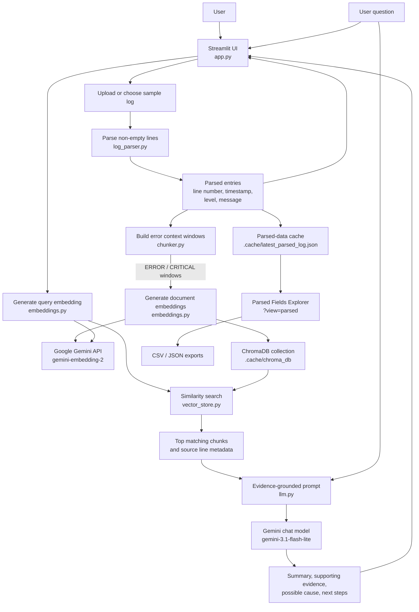
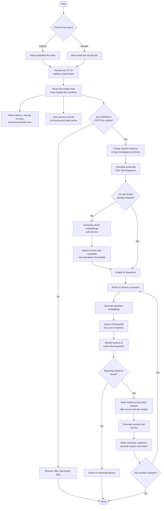

# AI Log Analysis Assistant

AI Log Analysis Assistant is a Streamlit application for exploring application and service logs. It parses log lines into structured fields, highlights error context, indexes that context for semantic search, and uses Google's Gemini API to answer questions grounded in retrieved log evidence. This makes hosted deployment possible without running a local language model.

## Features

- **Upload logs or try built-in samples.** Accepts `.log`, `.txt`, and `.out` files and includes fictional sample scenarios for database outages, application crashes, authentication incidents, network failures, and general errors.
- **Parse common log formats.** Extracts original line numbers, timestamps, severity levels, and messages. Recognizes ISO-style, numeric-date, Apache-style, and syslog-style timestamps, and common severity labels such as `ERROR`, `CRITICAL`, `WARN`, `INFO`, and `DEBUG`.
- **Focus analysis on failures.** Builds context windows around `ERROR` and `CRITICAL` entries, including up to three parsed entries before and after each failure. Overlapping or adjacent windows are merged.
- **Ask questions in natural language.** Retrieves up to five semantically relevant failure chunks and asks Gemini to summarize evidence, discuss possible causes, and suggest next steps.
- **Inspect the source and evidence.** The response prompt requests citations to source files and line ranges; retrieved chunks and their Chroma cosine distances are also shown in the UI.
- **Explore and export parsed records.** The parsed-fields view supports text search, severity filtering, row limits, and CSV/JSON downloads.
- **Filter and download raw logs.** The console supports keyword, error-only, and warning-only filters, display limits, and downloads of the original or filtered log.
- **Use hosted inference.** Gemini generates both embeddings and chat responses; ChromaDB stores the vectors in the app's local filesystem.

## Advantages

- **Faster troubleshooting:** Automatically locates error-related sections and retrieves relevant context, reducing manual scanning of long log files.
- **More useful context:** Includes nearby entries before and after failures, helping reveal the sequence of events around an incident.
- **Natural-language investigation:** Lets users ask questions about the logs instead of relying only on exact keyword searches.
- **Evidence that can be checked:** Shows retrieved excerpts and source line ranges alongside AI-generated explanations so findings can be compared with the original log.
- **Remote deployment:** Uses the Gemini API instead of requiring a local Ollama service, so it can run on a hosted Streamlit service.
- **Data handling:** Log chunks are sent to Google to generate embeddings, and retrieved excerpts are sent to Google again to answer questions. Do not upload sensitive logs unless this is permitted by your organization's policies and Google's applicable terms.
- **Practical log exploration:** Provides structured fields, severity and keyword filters, and CSV/JSON exports for follow-up analysis.

This application is a troubleshooting assistant, not an automatic root-cause authority. AI explanations are suggestions and should be verified against the original logs and relevant system context.

## Architecture



## Workflow

The flow below shows what happens from log selection through indexing and AI-assisted investigation:



## How analysis works

1. **Read and parse:** `app.py` decodes the selected file as UTF-8 (replacing undecodable bytes) and passes its contents to `parse_log_lines`. Empty lines are skipped while original line numbers are retained.
2. **Build failure context:** `create_event_chunks` selects parsed entries whose level is exactly `ERROR` or `CRITICAL`. By default, it includes three entries on each side of each selected entry and merges overlapping or adjacent windows. Logs without these levels can still be browsed, but do not produce AI-analysis chunks.
3. **Index failure context:** `ChromaVectorStore` creates embeddings with Gemini's `gemini-embedding-2` model and upserts them into a ChromaDB collection using cosine distance. Each chunk carries source name, line range, chunk index, and failure-line metadata.
4. **Scope retrieval to the active file:** The app calculates a SHA-256 identifier from the filename and file bytes. It uses this identifier when indexing and searching so a question is matched against chunks for the active upload or sample.
5. **Retrieve and answer:** The question is embedded and used to retrieve at most five chunks for the active file. `generate_log_analysis` gives those chunks and the question to Gemini's `gemini-3.1-flash-lite` model, falling back to `gemini-2.5-flash` if the primary returns a temporary 503 unavailable error. Its prompt treats logs as untrusted evidence, asks the model not to invent facts, distinguishes observations from possible causes, and requests cited line ranges.
6. **Display and export:** The main view shows the answer and retrieved evidence. A separate parsed-fields view is available at `?view=parsed`; parsed entries are cached in memory and in `.cache/latest_parsed_log.json` so they can be displayed in another browser tab.

## Technology

- Python 3.10 or newer
- Streamlit for the web interface
- Google Gemini API for chat completion and embeddings (via the Google Gen AI SDK)
- ChromaDB for persistent vector storage
- Pandas for parsed-log tables and exports
- `unittest` for the test suite

## Models used

The app calls the Gemini API using these models:

| Purpose | Model | How it is used |
| --- | --- | --- |
| Embeddings | `gemini-embedding-2` | Converts error-context chunks and user questions into vectors for semantic search in ChromaDB. |
| LLM / chat completion | `gemini-3.1-flash-lite` (fallback: `gemini-2.5-flash`) | Analyzes the question together with retrieved log evidence and generates the troubleshooting response. The app automatically tries the fallback if the primary model returns a temporary 503 unavailable error. |

### Why does the app call an LLM?

Embeddings help the app find log chunks that are semantically related to a question, but they do not explain what those logs mean or produce a natural-language answer. After retrieval, the app calls Gemini with the question and matching log excerpts so it can summarize the observed evidence, describe possible causes, and recommend next debugging steps. The prompt asks the model to ground its answer in the supplied logs and cite source line ranges. Treat the output as troubleshooting guidance and verify it against the original logs.

## Prerequisites

1. Install Python 3.10 or newer.
2. Create a Gemini API key in [Google AI Studio](https://aistudio.google.com/apikey).
3. Configure the key as `GOOGLE_API_KEY` in your environment or Streamlit secrets. Never commit the key to source control.

The default model names are defined in `embeddings.py` and `llm.py`.

## Install and run

From the project directory, create and activate a virtual environment, install dependencies, then launch Streamlit:

```powershell
py -3.10 -m venv .venv
.\.venv\Scripts\Activate.ps1
python -m pip install --upgrade pip
python -m pip install -r requirements.txt
streamlit run app.py
```

Open the local URL printed by Streamlit. Upload a log file or select a built-in sample. The **AI Failure Investigation & Root Cause** tab is enabled for logs with `ERROR` or `CRITICAL` entries once embeddings have been generated. The **Raw Log Console & Filter Explorer** tab can be used to search and filter the source log.

For a local PowerShell session, set the API key before starting the app:

```powershell
$env:GOOGLE_API_KEY = "your-google-api-key"
streamlit run app.py
```

### Deploy on Streamlit Community Cloud

1. Push this project to a GitHub repository.
2. In [Streamlit Community Cloud](https://share.streamlit.io/), create an app from that repository and select `app.py` as the entry point.
3. Add the following to the app's **Secrets** settings:

   ```toml
   GOOGLE_API_KEY = "your-google-api-key"
   ```

4. Deploy the app. Streamlit installs the dependencies from `requirements.txt`.

ChromaDB uses the app's filesystem for its vector collection. Hosted app filesystems may be temporary, so logs may need to be re-indexed after a restart or redeployment.

Anyone with access to the deployed app can use its Gemini API key indirectly and may generate API usage or charges. Restrict app access as appropriate, and monitor the key's quota and billing.

If PowerShell blocks virtual-environment activation due to its execution policy, use an appropriate policy for your machine or run the environment's Python executable directly, for example:

```powershell
.\.venv\Scripts\python.exe -m pip install -r requirements.txt
.\.venv\Scripts\streamlit.exe run app.py
```

## Run tests

With the project dependencies installed:

```powershell
python -m unittest discover -v
```

Select one of the bundled fictional sample logs from **Quick Demo Logs** to test parsing, semantic search, and AI analysis without uploading real log data. Gemini API calls still transmit the sample excerpts to Google and require a configured API key.

The tests cover parsing, error-context chunking, embedding and chat wrappers, and Chroma vector-store behavior. Model/network calls are mocked in the relevant unit tests, so a Gemini API key is not needed to run the suite.

## Project structure

| File or directory | Purpose |
| --- | --- |
| `app.py` | Streamlit application, upload and sample selection, analysis workflow, log console, parsed-fields view, and exports. |
| `log_parser.py` | Parses non-empty log lines into line number, timestamp, severity, and message fields. |
| `chunker.py` | Creates and merges contextual windows around `ERROR` and `CRITICAL` entries. |
| `embeddings.py` | Generates document and query embeddings with Gemini's `gemini-embedding-2` model. |
| `vector_store.py` | Stores and searches embedded chunks in a persistent ChromaDB collection. |
| `llm.py` | Formats retrieved evidence and questions for Gemini, with a fallback model for temporary primary-model unavailability. |
| `gemini_client.py` | Loads the Gemini API key from the environment or Streamlit secrets and creates the API client. |
| `requirements.txt` | Python runtime dependencies. |
| `test_*.py` | Unit tests for the parser, chunker, embedding wrapper, LLM wrapper, and vector store. |
| `sample_database.log` | Database outage demo log. |
| `sample_application.log` | Application crash and data-processing demo log. |
| `sample_authentication.log` | Authentication incident demo log. |
| `sample_network.log` | Network failure demo log. |
| `sample_error.log` | General error sample and fallback data for the parsed-fields view. |
| `.cache/` | Runtime data: persistent ChromaDB files and the latest parsed-log cache. Created/used by the application. |

## Local data and GitHub publishing

The vector database and parsed-log cache are stored under `.cache/`. They can contain log-derived text, so do not upload them to a public repository. The virtual environment (`.venv/`) is also machine-specific and should not be committed. Before publishing, ensure your Git ignore rules exclude at least:

```gitignore
.venv/
.cache/
__pycache__/
*.py[cod]
```

Sample logs are part of the project; review them before publishing to ensure they contain no sensitive or real production data. Log chunks are sent to Google's Gemini API to create embeddings. Retrieved log excerpts and the user's question are sent to Gemini again to generate an answer. Do not use the application with confidential logs unless this data sharing is approved under your organization's policies and Google's applicable terms. The API key must be stored as a secret and must never be exposed in source code or client-side UI.

## Limitations

- Log parsing is based on regular-expression patterns, not a format-specific schema. Unrecognized lines are retained as messages, but their timestamps or severity may not be extracted.
- Only `ERROR` and `CRITICAL` levels are selected for semantic indexing; other recognized severities remain available in the parsed view and raw console.
- Root-cause explanations are model-generated suggestions, not guaranteed diagnoses. Validate them against operational evidence.
- The default Gemini model names are currently configured in source rather than exposed as application settings.

## License

No license file is currently included. Add a license before publishing if you want to explicitly grant others permission to use, modify, or distribute this project.
